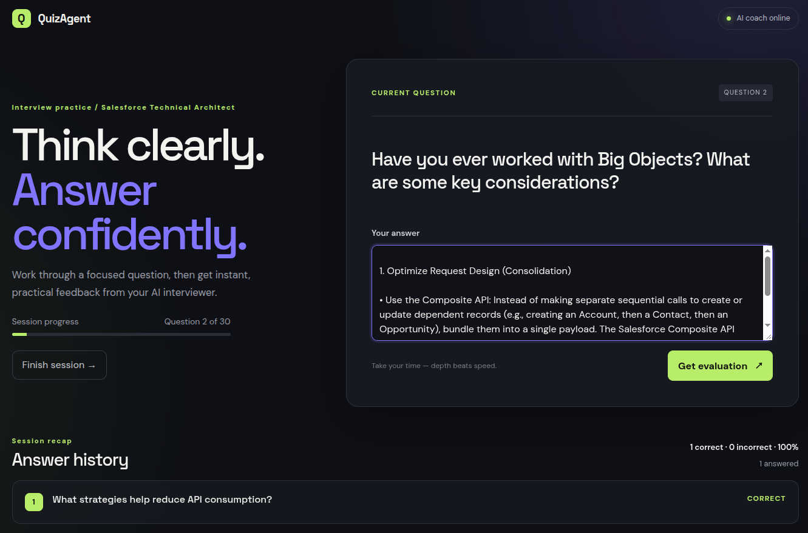
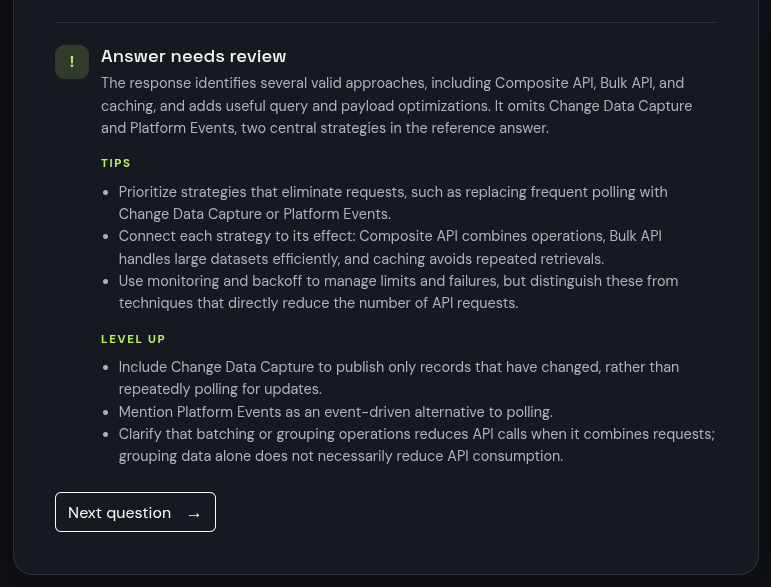

# QuizAgent

QuizAgent is a web application for practicing interview questions. It presents questions from an
Excel question bank, uses an AI model to evaluate written answers, and provides a session history
with correctness feedback and a score summary.

<div style="text-align: center">
  </img>
</div>
<br/>

## Application functionality

- Selects a random question from the configured question bank.
- Evaluates the submitted answer against a reference answer using an AI chat model.
- Displays whether the answer is correct, a justification, tips, and enhancement suggestions.
- Tracks answers, correct and incorrect counts, and the correct-answer percentage for each session.
- Lets the user end a session after confirming that its answer history should be deleted.

<div style="text-align: center">
  </img>
</div>
<br/>

## How it works

The application is built with Java 21 and Spring Boot. The browser frontend is served from
`src/main/resources/static` and communicates with the REST API:

1. At startup, `ExcelImportService` checks whether flashcards already exist in the database. If none
   exist, it imports questions from the configured Excel workbook.
2. `GET /api/quiz/question` returns a random question and the total question count.
3. The frontend submits the question, reference answer, and user answer to
   `POST /api/quiz/evaluate`.
4. `QuizAgentService` sends those values to the Spring AI `ChatClient`, which uses the configured
   OpenAI chat model and returns structured evaluation data.
5. `QuizHistoryService` stores evaluations by session ID. The frontend loads history from
   `GET /api/quiz/history` and removes it through `DELETE /api/quiz/history` when the user confirms
   session termination.

The main API routes are:

| Method   | Path                 | Purpose                                                   |
|----------|----------------------|-----------------------------------------------------------|
| `GET`    | `/api/quiz/topic`    | Returns the configured interview topic                    |
| `GET`    | `/api/quiz/question` | Returns a random question and total count                 |
| `POST`   | `/api/quiz/evaluate` | Evaluates an answer and stores the result                 |
| `GET`    | `/api/quiz/history`  | Returns history for the session ID in `X-Quiz-Session-Id` |
| `DELETE` | `/api/quiz/history`  | Deletes history for the session ID in `X-Quiz-Session-Id` |

## Run on Linux

### Prerequisites

- Java 21
- Maven 3.9 or newer
- An API key accepted by the configured OpenAI chat endpoint

From the project root, set the required key and start the application:

```bash
export OPENAI_API_KEY="your-api-key"
mvn spring-boot:run
```

Then open [http://localhost:8080](http://localhost:8080).

To build and run the packaged application:

```bash
mvn clean package
java -jar target/quiz-agent-0.0.1-SNAPSHOT.jar
```

## Configure the application

Configuration is in `src/main/resources/application.yaml`. The following environment variables are
referenced there; values in parentheses are the configured defaults.

| Environment variable                                                | Purpose                                                                                       |
|---------------------------------------------------------------------|-----------------------------------------------------------------------------------------------|
| `APP_INTERVIEW_TOPIC` (`Salesforce Technical Architect`)            | Topic shown in the frontend                                                                   |
| `APP_QUESTIONS_FILE` (`classpath:questions/questions-answers.xlsx`) | Classpath or Spring resource location of the Excel question bank                              |
| `OPENAI_API_KEY` (required)                                         | Credential for the AI provider                                                                |
| `OPENAI_MODEL` (`gpt-6-luna`)                                       | Chat model name                                                                               |
| `OPENAI_REASONING_EFFORT` (`low`)                                   | Model reasoning effort                                                                        |
| `OPENAI_BASEURL` (`https://api.openai.com/v1`)                      | OpenAI-compatible API base URL                                                                |
| `DATASOURCE_URL` (`jdbc:h2:file:./data/quiz-agent-db`)              | JDBC connection URL                                                                           |
| `DATASOURCE_DRIVER_CLASS` (`org.h2.Driver`)                         | JDBC driver class                                                                             |
| `DATASOURCE_USERNAME` (`sa`)                                        | Database username; the variable is spelled `DATASOURCE_USERNAME` in the current configuration |
| `DATASOURCE_PASSWORD` (empty)                                       | Database password; the variable is spelled `DATASOURCE_PASSWORD` in the current configuration |
| `H2_CONSOLE_ENABLED` (`true`)                                       | Enables the H2 web console                                                                    |
| `H2_CONSOLE_WEB_ALLOW_OTHERS` (`true`)                              | Allows H2 console access from other hosts                                                     |
| `OPENAI_CHAT_LOGLEVEL` (`INFO`)                                     | Log level for Spring AI chat client logging                                                   |

For example, to select a different topic and use a compatible provider endpoint:

```bash
export APP_INTERVIEW_TOPIC="Java Backend Engineer"
export OPENAI_API_KEY="your-api-key"
export OPENAI_MODEL="your-model-name"
export OPENAI_BASEURL="https://your-provider.example/v1"
mvn spring-boot:run
```

The default database is a file-based H2 database under `./data`, relative to the directory from
which the application starts. The H2 console is enabled and configured to allow other hosts by
default; disable it or restrict access when running outside a trusted development environment:

```bash
export H2_CONSOLE_ENABLED=false
export H2_CONSOLE_WEB_ALLOW_OTHERS=false
```

Do not commit API keys or other credentials to source control.

## Configure the Excel question bank

The default workbook is `src/main/resources/questions/questions-answers.xlsx`. The configured
location is `classpath:questions/questions-answers.xlsx` in `application.yaml`.

The importer reads the first worksheet, skips row 1 as the header, and expects:

- Column B: question text
- Column C: reference answer

Each question and answer cell must contain text. Rows with an empty or whitespace-only question, or
with either required cell missing, are skipped. Keep a header row in row 1 even when its labels are
simple, for example `Question` in column B and `Answer` in column C.

To use a different workbook, update `spring.application.questions-file-location` in
`application.yaml` to its classpath or Spring resource location and include the workbook at that
location in the application. The import runs only when the database contains no flashcards. Changing
the workbook does not replace already imported questions. To load a revised question bank, use a
fresh/empty database configured with `DATASOURCE_URL`, then restart the application.
